# ⚽ Judge App

> O juiz de bolso da pelada: sorteio de coletes, fila automática, cronômetro, placar e histórico na nuvem. Um PWA que se instala no celular e funciona até sem sinal na quadra.


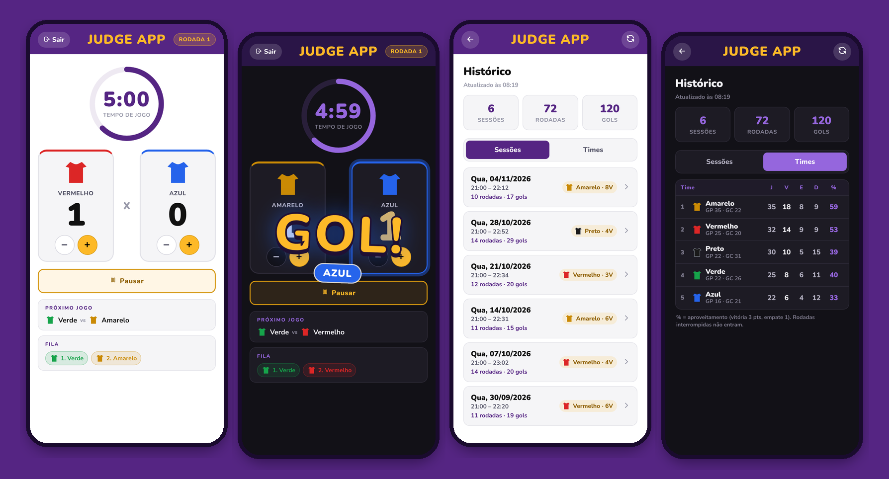

🔗 **[Acessar o app → appjudge.netlify.app](https://appjudge.netlify.app/)**

---

## 🎯 O problema

Toda quarta-feira, a pelada da **FUT&SAL** tinha as mesmas discussões: *quem entra agora?*, *quanto tempo falta?*, *esse time já ganhou três?*. A fila era controlada de cabeça, o tempo no relógio de alguém e o sorteio de coletes no improviso.

O **Judge App** nasceu para resolver isso de verdade, na quadra, com usuários reais. Ele virou o "juiz" que todo mundo respeita: aplica as regras da fila sozinho, cronometra, marca o placar e guarda o histórico de cada dia de jogo.

## ✨ Destaques

**Na quadra**
- **Sorteio de coletes balanceado:** cada cor recebe um jogador por rodada e a mesma cor nunca sai duas vezes seguidas (máx. 5 por cor)
- **Fila com arrastar e soltar**, no estilo playlist: sorteie e ajuste a ordem com o dedo
- **Cronômetro com anel de progresso** e encerramento automático por **tempo ou gols** (o que vier primeiro)
- **Regras da fila aplicadas automaticamente**: vitória, empate e 3 vitórias seguidas
- **Tela sempre acesa** durante a partida (Screen Wake Lock)
- **Sons de apito e gol** e vibração no Android

**Experiência**
- **"GOL!" animado** na cor do time, placar que pulsa e **confete na vitória**
- **Transições entre telas** com a View Transitions API
- **Modo escuro** automático (segue o celular) ou manual
- Respeita **"reduzir movimento"** do sistema (acessibilidade)

**Dados**
- **Funciona offline:** o estado da partida sobrevive a recarregar, fechar o app ou ficar sem bateria
- **Histórico na nuvem** com login: sessões, rodadas e **tabela de estatísticas por time** (J, V, E, D, gols e aproveitamento)
- **Sincronização offline-first:** joga sem internet e o app envia tudo quando a conexão volta
- Renomear e excluir sessões (para testes não poluírem as estatísticas)

---

## 📱 Telas

| Regras | Times & fila | Partida | Gol! |
|:---:|:---:|:---:|:---:|
| 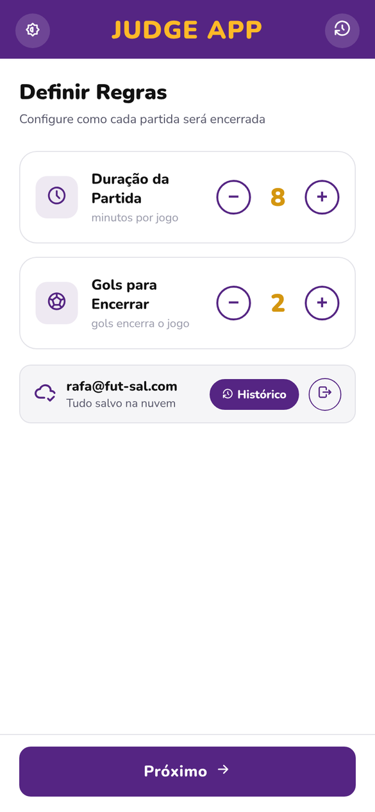 | 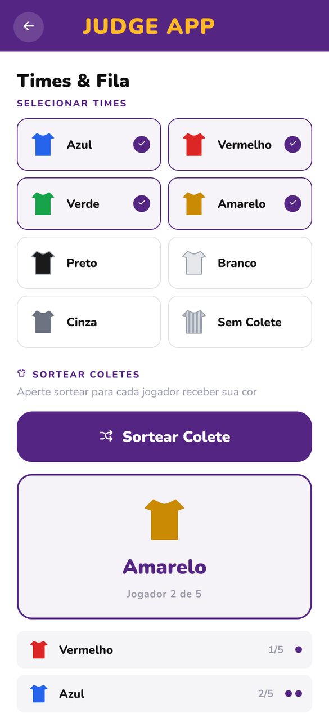 | 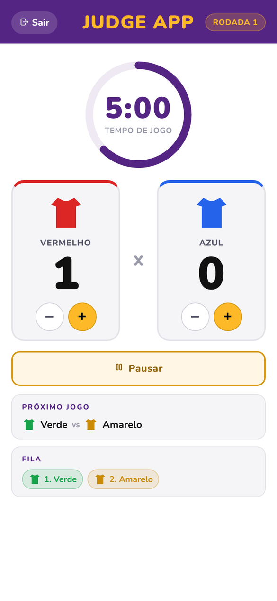 | 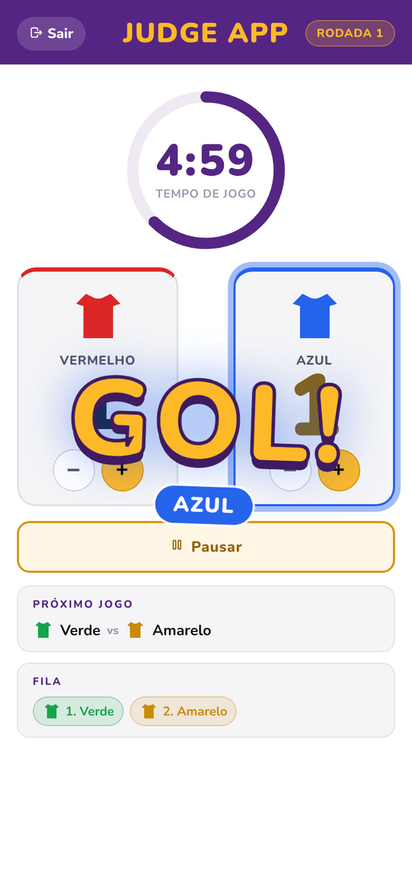 |
| **Resultado** | **Histórico** | **Estatísticas** | **Detalhe da sessão** |
| 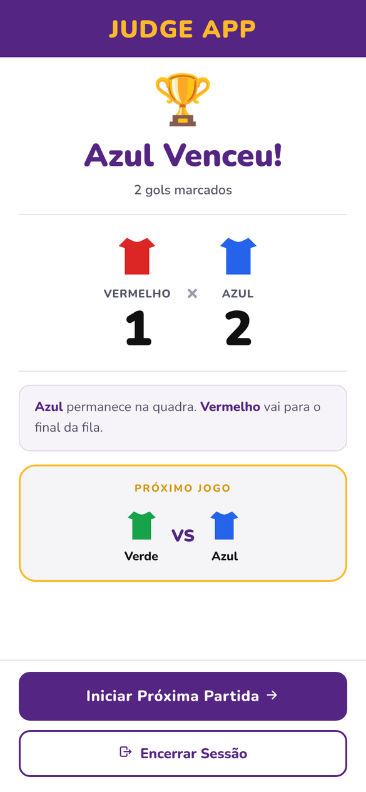 | 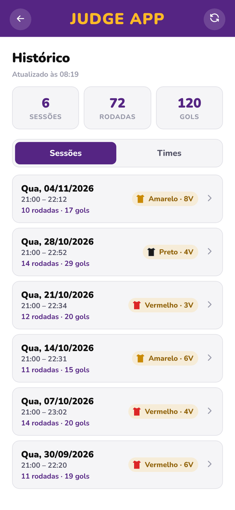 | 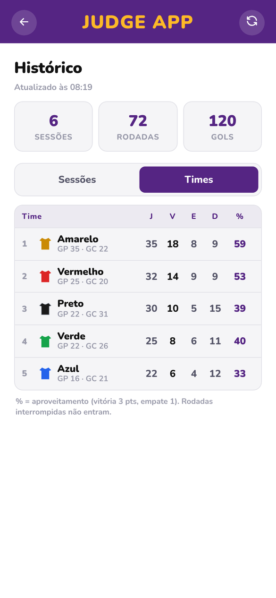 | 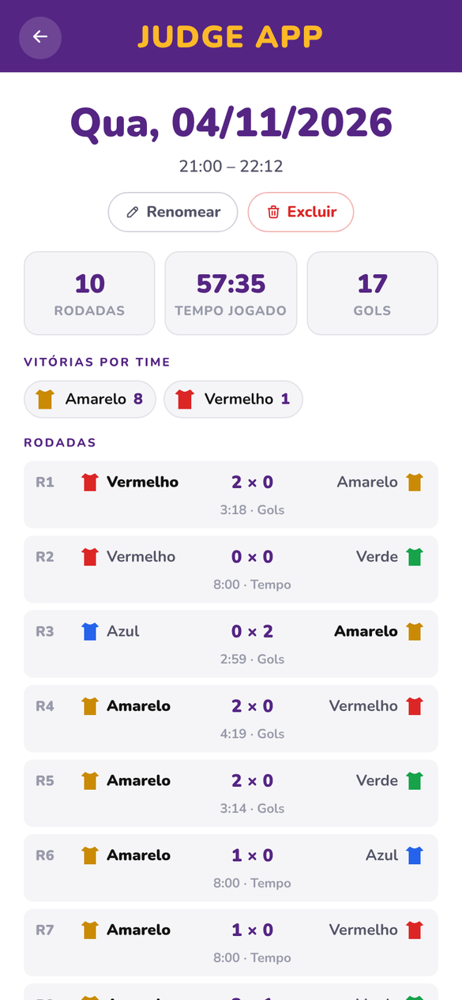 |

<details>
<summary><b>🌙 Modo escuro</b></summary>
<br>

| Partida | Estatísticas |
|:---:|:---:|
| 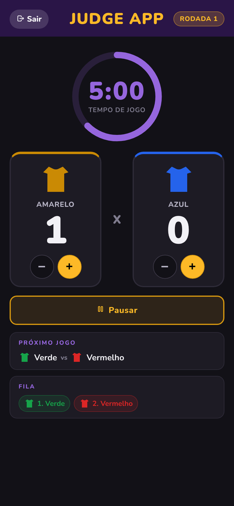 | 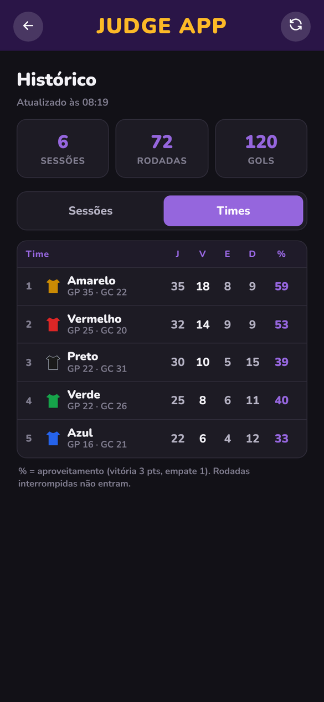 |

</details>

> Prints gerados com dados de exemplo.

---

## 📋 Regras da fila

| Situação | O que acontece |
|---|---|
| Um time vence | O vencedor fica na quadra e o perdedor vai para o fim da fila |
| Empate | Os dois saem; um sorteio define qual entra antes na fila |
| 3 vitórias seguidas | Os dois saem; **o perdedor entra na fila antes do vencedor** |

A partida termina no **primeiro critério** atingido: tempo (1 a 30 min) ou gols (1 a 10).

---

## 🏗️ Arquitetura

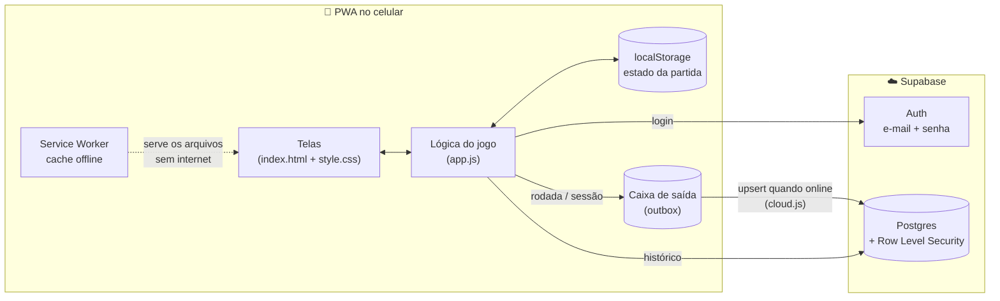

### Offline-first: como a sincronização funciona

A quadra nem sempre tem sinal, então **o celular é a fonte da verdade durante o jogo** e a nuvem recebe os dados depois:

1. Cada rodada encerrada entra numa **caixa de saída (outbox)** salva no `localStorage`.
2. Com internet **e** usuário logado, a fila é enviada em ordem para o Supabase.
3. Os **IDs (UUID) são gerados no próprio aparelho**, e o envio usa `upsert`. Por isso, reenviar nunca duplica dados.
4. Se der erro, o app tenta de novo a cada 30 s, quando a conexão volta (`online`) e quando o app volta para a tela (`visibilitychange`).
5. Jogou sem estar logado? As sessões ficam guardadas e sobem assim que você entra.

### Modelo de dados

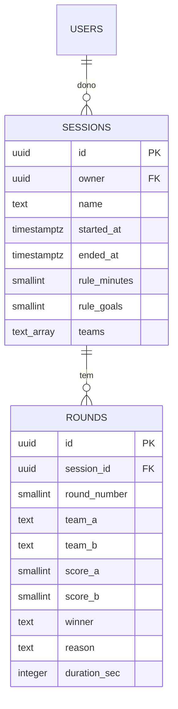

O schema completo está em [`supabase/schema.sql`](supabase/schema.sql).

### Segurança

- **Row Level Security** em todas as tabelas: cada usuário só lê e altera os **próprios** dados (`owner = auth.uid()`).
- O `owner` é preenchido pelo banco (`default auth.uid()`), não pelo cliente.
- O front usa apenas a chave **publishable**, que é pública por natureza. A chave `service_role` nunca sai do painel.

---

## 🧠 Decisões técnicas

| Decisão | Por quê |
|---|---|
| **JavaScript puro, sem build** | Deploy instantâneo e zero dependências para manter. O foco foi validar o produto com usuários reais antes de adotar um framework. |
| **Login por e-mail + senha** (e não link mágico) | No iPhone, o PWA instalado tem armazenamento separado do Safari: um link mágico abriria no navegador e não logaria o app. |
| **IDs gerados no cliente + `upsert`** | Permite criar dados offline e reenviar com segurança (idempotência). |
| **Recursos web modernos como melhoria progressiva** | View Transitions, Wake Lock e vibração funcionam onde há suporte; onde não há, o app segue normal. |
| **Pointer Events para arrastar e soltar** | Um único código funciona com dedo e mouse, sem biblioteca. |
| **Sorteio em rodadas** | Evita sequências injustas como "verde, verde, verde" e garante 5 jogadores por cor. |

---

## 🛠️ Tecnologias

- **HTML5, CSS3 e JavaScript** (vanilla), com variáveis CSS, temas e safe area para notch e Dynamic Island
- **PWA:** Web App Manifest + Service Worker (cache offline)
- **Supabase:** Auth e PostgreSQL com Row Level Security
- **APIs web:** View Transitions, Screen Wake Lock, Vibration, Pointer Events, `prefers-color-scheme` e `prefers-reduced-motion`
- **Netlify:** deploy contínuo a partir do GitHub
- **Nunito** (Google Fonts) e **Tabler Icons**

---

## 📁 Estrutura

```
judge.app/
├── index.html            # Todas as telas (SPA sem framework)
├── manifest.json         # Configuração do PWA
├── sw.js                 # Service Worker (cache offline)
├── css/
│   └── style.css         # Design system, temas claro/escuro, animações
├── js/
│   ├── app.js            # Regras do jogo, telas, histórico, efeitos
│   ├── cloud.js          # Login + sincronização offline-first (outbox)
│   └── config.js         # URL e chave publishable do Supabase
├── supabase/
│   └── schema.sql        # Tabelas, índices e políticas de segurança
├── sounds/               # Apito de início, gol e fim
├── icons/                # Ícones do PWA
└── docs/screenshots/     # Imagens deste README
```

---

## 🚀 Rodando localmente

```bash
git clone https://github.com/rafaelmestre/judge.app.git
cd judge.app
npx serve .
```

Abra o endereço que aparecer no terminal. Não há build: é editar e recarregar.

**Nuvem (opcional):** sem configuração, o app funciona 100% local. Para ativar o histórico na nuvem:

1. Crie um projeto no [Supabase](https://supabase.com) e rode `supabase/schema.sql` no **SQL Editor**.
2. Coloque a **Project URL** e a chave **publishable** em `js/config.js`.
3. Em **Authentication → URL Configuration**, defina a URL do seu site.

## 🔄 Deploy

Deploy contínuo **GitHub → Netlify**: cada `push` na `main` publica uma nova versão. O Service Worker é versionado (`CACHE` em `sw.js`), então os celulares recebem a atualização ao reabrir o app.

---

## 🗺️ Roadmap

**Feito**
- [x] Regras configuráveis, sorteio de coletes e fila automática
- [x] Fila com arrastar e soltar e sessão com confirmação de saída
- [x] PWA instalável e offline
- [x] Sons de apito e gol
- [x] Histórico na nuvem com estatísticas por time
- [x] Modo escuro, animações e tela sempre acesa

**Próximos passos: versão para torneios**
- [ ] Cadastro de jogadores, com artilharia e presença
- [ ] Placar ao vivo para a torcida (Supabase Realtime)
- [ ] Várias quadras ao mesmo tempo
- [ ] Tabela e chaveamento de torneio
- [ ] App nas lojas com Ionic + Capacitor

---

## 👤 Autor

**Rafael Mestre A. Araujo**: estudante de Análise e Desenvolvimento de Sistemas (PUC Minas) e organizador da pelada que inspirou o app.

- GitHub: [@rafaelmestre](https://github.com/rafaelmestre)
